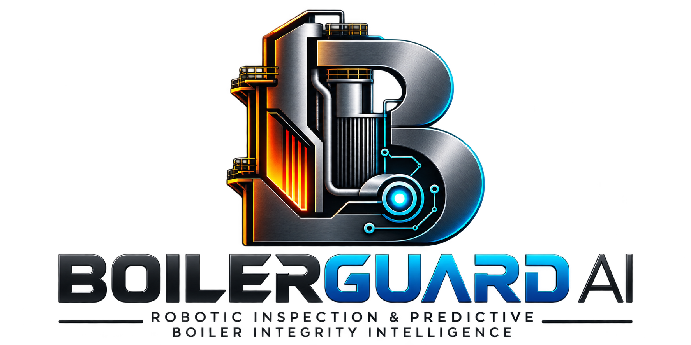

# BOILERGUARD AI

**Intelligent boiler inspection and predictive integrity platform.** A working full-stack prototype for
inspecting thermal power plant boilers faster and more safely, and for keeping every component's condition
history in one traceable record.

> **Demonstration prototype.** All plant, boiler, measurement, image and device data in this repository are
> **simulated sample data** and are labelled as such. AI outputs are demonstration heuristics. BOILERGUARD AI is an
> inspection-intelligence and decision-support tool. It is **not** an autonomous safety certification system, and it
> does not replace statutory inspection or review by a qualified engineer.

---

## The central idea: the Boiler Memory Engine

Most inspection tools record findings from one visit. BOILERGUARD keeps a persistent record for each boiler
component (for example `ECO-TUBE-024`). Every new inspection is attached to that component, and new readings are compared
only with earlier readings that are actually comparable: same location, same method, same unit and acceptable quality.

Using the demonstration values from the problem statement, the economiser tube's recorded wall thickness goes
**5.8 → 5.6 → 5.3 mm**. The engine flags the latest 0.3 mm loss for engineering review, shows the evidence
behind the flag, and does not extrapolate a deterioration rate or a failure date.

The demonstration path, end to end:

1. Select a boiler component in the digital twin.
2. Open its history in the Boiler Memory Engine.
3. Create an inspection and upload evidence linked to the component.
4. Run the demonstration defect analysis. Its findings start as *AI-suspected*.
5. Record a measurement. It is compared with the nearest comparable earlier reading.
6. Verify or reject each finding. Rejections need a written reason.
7. Read the explainable risk assessment, with every factor linked to its records.
8. Add a follow-up maintenance action and generate a PDF engineering report.

Every step writes to an audit trail with user, role and time.

## What is implemented

| Module (problem statement) | Where it lives | Status |
|---|---|---|
| 1. Command Centre | `/dashboard` · `analytics/command_centre.py` | Counts, condition distribution, watchlist, feed, activity |
| 2. Interactive Boiler Digital Twin | `/digital-twin` · `components/BoilerSchematic.tsx` | Clickable conceptual schematic, engineering panel, trend |
| 3. Inspection Workspace | `/inspections`, `/inspections/[id]` | Sessions, JPEG/PNG upload with SHA-256, measurements, CSV import, status lifecycle |
| 4. AI Defect Detection | `/defect-intelligence` · `ai/analyzer.py` | Swappable analyzer interface, annotated output, verify / reject / test workflow |
| 5. Boiler Memory Engine | `/boiler-memory` · `services/memory_engine.py` | Timeline, comparability rules, flagged changes, defect progression, limitations |
| 6. Explainable Risk Intelligence | `/risk-intelligence` · `services/risk_engine.py` | Five categories, factor-by-factor evidence, engineer review record |
| 7. Robotics & Sensor Intelligence | `/robotics` · `integrations/devices.py` | Device registry, simulated ultrasonic feed labelled DEMO, batch data-quality |
| 8. Shutdown & Inspection Planner | `/inspection-planner` · `services/planner.py` | Plans grouped by method class, statutory items protected, maintenance actions |
| 9. Engineering Reports | `/reports` · `reporting/pdf_report.py` | PDF with record IDs, limitations, sign-off block; CSV exports |
| 10. Asset & Data Management | `/assets`, `/settings` | Plants, boilers, component registry, users and roles, audit log, demo reset |

Additional cross-cutting requirements: JWT authentication, role-based permissions enforced on the API, input
validation (Pydantic and file-level checks), traceable evidence fingerprints, search and filters on list
endpoints, CSV export, error states in the UI, and automated tests.

## Quick start

### Option A: Docker Compose (PostgreSQL, API and web)

```bash
cp .env.example .env          # then set JWT_SECRET to a long random value
docker compose up --build
```

Open <http://localhost:3000>. The API docs are at <http://localhost:8000/docs>.

### Option B: local development (SQLite, no Docker)

Backend (Python 3.12 or newer):

```bash
cd backend
python -m venv .venv && source .venv/bin/activate      # Windows: .venv\Scripts\activate
pip install -r requirements.txt
export JWT_SECRET="$(python -c 'import secrets; print(secrets.token_urlsafe(48))')"
uvicorn app.main:app --reload --port 8000
```

Frontend (Node.js 20 or newer):

```bash
cd frontend
npm install
cp .env.example .env.local     # NEXT_PUBLIC_API_URL=http://localhost:8000
npm run dev                    # http://localhost:3000
```

On first start the API creates its tables and loads the demonstration dataset. To reload it later, sign in as an
administrator and use *Settings → Reset demonstration data*, or run `./scripts/reset_demo.sh` while the API is running.

### Demonstration accounts

| Role | Email | Password | Can |
|---|---|---|---|
| Administrator | admin@boilerguard.demo | Admin@12345 | Everything, including users, audit log and reset |
| Inspection Engineer | engineer@boilerguard.demo | Engineer@12345 | Inspections, evidence, measurements, verification, risk review, reports |
| Maintenance Manager | manager@boilerguard.demo | Manager@12345 | Plans, maintenance actions, reports |
| Viewer | viewer@boilerguard.demo | Viewer@12345 | Read and download only |

These passwords exist only for the demonstration dataset. Change them, or remove the seeded accounts, before any shared deployment.

## Tests

```bash
cd backend && python -m pytest                 # 29 tests: auth and permissions, memory engine, risk rules,
                                               # CSV validation, end-to-end API workflow, demo reset
cd frontend && npm run typecheck && npm run build
# With the API and web app running:
BASE_URL=http://localhost:3000 node tests/e2e/workflow.mjs   # browser test of the critical engineer workflow
```

The backend suite uses an isolated SQLite database per run. CI (`.github/workflows/ci.yml`) runs the backend tests,
the type check and the production build on every push.

## Repository layout

```
boilerguard-ai/
├── frontend/          Next.js 15 (App Router), React 19, TypeScript, Tailwind, Recharts, Framer Motion
│   ├── app/           Routes: (workspace)/* pages behind the sidebar shell, login
│   ├── components/    UI primitives, app shell, interactive boiler schematic
│   ├── features/      Auth context
│   ├── hooks/         Data-loading hook with loading and error states
│   ├── lib/           API client (bearer token, normalised errors, protected downloads)
│   └── types/         Shared TypeScript models
├── backend/           FastAPI, Pydantic, SQLAlchemy
│   ├── app/api/       Routers by domain (auth, assets, inspections, intelligence, operations, admin)
│   ├── app/core/      Settings, database, security, permissions, audit
│   ├── app/models/    ORM entities
│   ├── app/schemas/   Request and response validation
│   ├── app/services/  Memory engine, risk engine, planner, analysis, storage, CSV import, sample data
│   ├── app/ai/        Defect-analyzer adapter interface, heuristic demo analyzer, sample image generator
│   ├── app/integrations/  Device adapters (simulated ultrasonic)
│   ├── app/reporting/ PDF and CSV generation
│   ├── app/analytics/ Command-centre aggregates
│   └── tests/         Automated tests
├── sample-data/       Labelled demonstration plant, components, inspections, measurements, images, devices
├── database/          Schema notes and migration plan
├── docs/              Architecture, API, technical design, validation, product alignment, walkthrough
├── scripts/           Sample-image generator, demo reset
├── tests/e2e/         Browser test for the critical workflow
├── docker-compose.yml
├── .env.example
└── LICENSE
```

## Engineering rules (summary)

Full detail is in `docs/technical-design/README.md`. Every threshold is a **demonstration value** set in
configuration, to be replaced with plant-approved design data.

- **Comparability.** Two readings are compared only if parameter, unit, method and location match and neither has
  *poor* quality.
- **Change flag.** A wall loss is flagged when it is at least 0.2 mm and larger than the 0.1 mm measurement uncertainty.
- **No extrapolation.** The engine reports observed change. It never outputs deterioration rates or failure dates.
- **Risk categories.** Critical Review, High Priority, Moderate Priority, Routine Monitoring, Insufficient Evidence.
  Rules are ordered. Each factor cites its records. The priority index only sorts review work. It is **not** a probability of failure.
- **Human decisions.** AI findings stay *AI-suspected* until an engineer verifies, rejects or flags them for testing.
- **Statutory protection.** Statutory plan items cannot be deleted. Closing an inspection is blocked while any finding is unresolved.

## Deployment

- **Frontend:** Vercel, or any Node host. Set `NEXT_PUBLIC_API_URL` to the public API URL.
- **Backend:** Render, Railway or similar, using `backend/Dockerfile`. Set `DATABASE_URL` to managed PostgreSQL,
  `JWT_SECRET`, `CORS_ORIGINS` to the web origin, and `SEED_DEMO_ON_START=false` for any non-demonstration environment.
- **Storage:** uploads and reports use local storage behind an interface. Replace `LocalFileStorage` with object storage
  for multi-instance deployments.

## Known limitations

Stated plainly, because they matter for evaluation:

- **Schema management.** Tables are created with SQLAlchemy `create_all` on start. Alembic migrations are the next step
  and are not yet generated.
- **AI analyzer.** The bundled analyzer detects rust-coloured regions and elongated dark streaks. It does not identify real
  corrosion or cracking. It is a replaceable adapter, and a validated model would need its own dataset and evaluation.
- **Hardware.** No real robot, camera or ultrasonic gauge is connected. The ultrasonic adapter is a simulator. Robotic and thermal
  integrations exist as registry entries and architecture placeholders.
- **Thresholds.** Nominal and minimum-required thicknesses and the change-flag values are demonstration numbers.
- **Auth.** JWT in the browser's local storage, with role checks on every API route. There is no SSO, MFA or
  refresh-token rotation yet.
- **Testing.** Backend tests cover the critical logic and API workflow. The browser test covers one golden path, not every page.
- **Reports.** PDFs are demonstration reports, not statutory certificates, and include a blank engineer sign-off block.

## Walkthrough

A page-by-page script for recording a demonstration video is in `docs/walkthrough/WALKTHROUGH.md`.

## Licence

MIT. See `LICENSE`.
